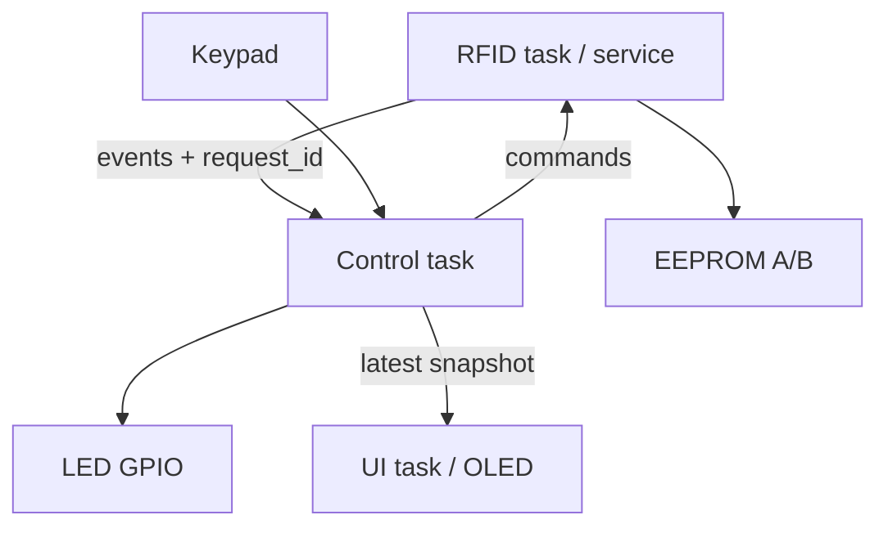

# Kiến trúc M3

| Chủ phần | Thành phần | Quyền sở hữu |
|---|---|---|
| Nguyễn Hữu Anh | task_rfid, RC522, service, config_store, EEPROM | SPI và cấu hình bền vững |
| Hà Xuân Khải | task_control, keypad, access_control | Phiên Admin, trạng thái, hạn đóng |
| Lê Quốc Khánh | task_ui, OLED, lock_output | Hiển thị và triển khai GPIO khóa |

Startup: board_init (HAL/clock/GPIO/bus) → khóa đóng → I2C mutex → IPC queues
→ tạo ba task → scheduler. Control gửi GET_STATUS, RFID load EEPROM. Khi chưa
có cấu hình hợp lệ thì SETUP_REQUIRED, không mở bằng PIN/thẻ chưa xác nhận.
Thất bại tạo queue/task giữ đóng và dừng bằng board_assert_failed.

FreeRTOS1kHz, heap_4 24KiB. Control ưu tiên3, RFID2, UI1; stack dự kiến lần lượt
512/768/512 words. GPIO khóa được cập nhật mỗi vòng control10ms, trước quét
keypad và sau tối đa4 event để tránh đói vòng điều khiển. Jitter thực chưa đo.
UI chỉ làm I2C có timeout; EEPROM/OLED dùng một mutex. Không chờ task khác khi
đang giữ bus. Snapshot dài1 được overwrite; command/event dùng queue FIFO8/16.

## Giao dịch

Control gửi một yêu cầu tại một thời điểm. Mỗi request_id khác0; counter32bit
skip0 khi tràn. Không có phản hồi tồn tại tới chu kỳ lặp hơn4 tỷ yêu cầu vì
FIFO/timeout hữu hạn; UI vẫn so cả ID và loại lệnh. Mutation chỉ do control
đang có quyền Admin gửi. API nội bộ không tiếp xúc mạng/UART.

Reply bị queue đầy được task_rfid giữ lại và retry; chưa nhận command mới cho
tới khi gửi được reply. Card event có thể bỏ khi đầy, có rfid_dropped_events;
không giả vờ đã nhận/lưu thẻ. RFID đã giữ thẻ thì cần nhả rồi quẹt lại.

Card event có thời điểm đọc. Control bỏ event quá500ms hoặc trước/cùng mili giây với lần đổi
trạng thái hiện tại, tránh thẻ trong Admin bị áp dụng sau khi đã thoát.
Ba poll liên tiếp NO_EVENT mới re-arm; lỗi SPI/RF không tính là nhả thẻ.

D khi đang chờ đánh dấu cancelled và xóa quyền Admin, nhưng giữ theo dõi yêu cầu
đến khi có phản hồi hoặc3s. Thành công auth đã hủy không mở/cấp quyền. Mutation
đã gửi vẫn có thể commit; kết quả thống kê phản ánh cấu hình thật.
Nếu timeout/IO_ERROR, khóa đóng và yêu cầu D→GET_STATUS để reload; reply cũ bỏ qua.
Mỗi kết quả command chứa count/mask/revision, không cần đọc lại sau mỗi menu.

## Dữ liệu nhạy cảm và lỗi

OLED chỉ nhận số ký tự PIN. Bộ đệm input/new_pin và bản sao command cục bộ được
xóa khi xong/hủy. Queue và EEPROM có thể còn PIN rõ; không tuyên bố secure erase
hay bảo vệ sản phẩm. CRC32 phát hiện hỏng dữ liệu, không phải xác thực mật mã.

Không có default auto-restore: hai bank invalid cần provision riêng. Thất bại
I/O khi đọc một bank không chọn đoán bank kia. Mutation chỉ báo OK sau verify;
trạng thái commit không rõ cần reload. STORAGE_FORMAT.md mô tả byte cụ thể.
